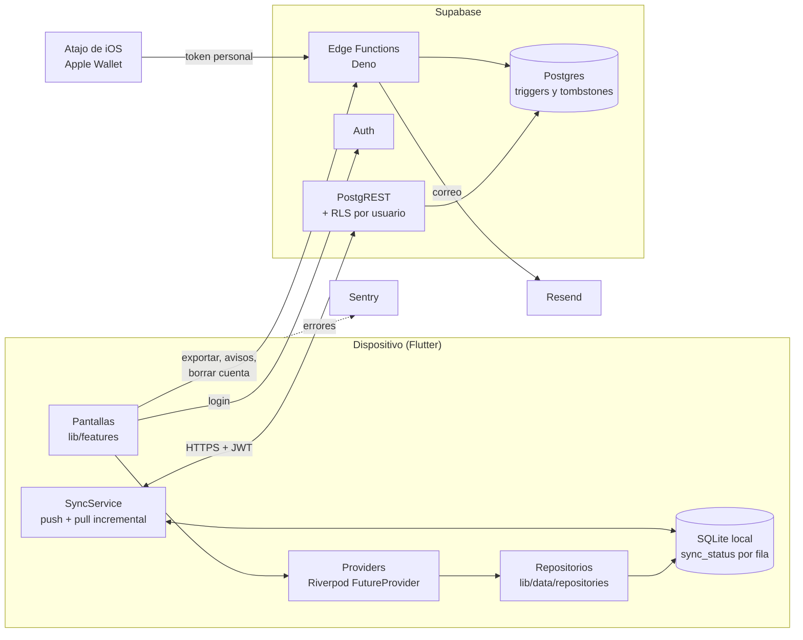
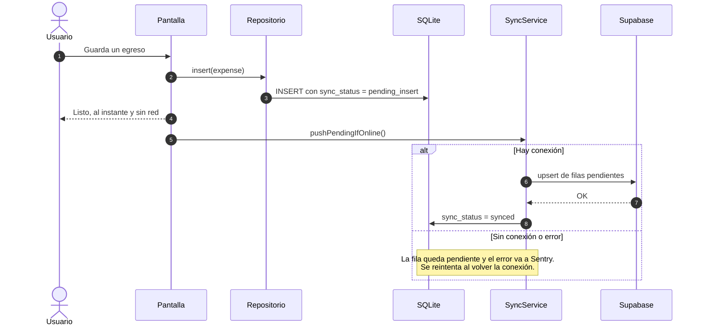
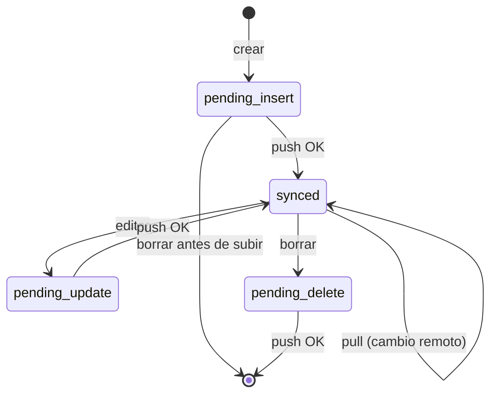
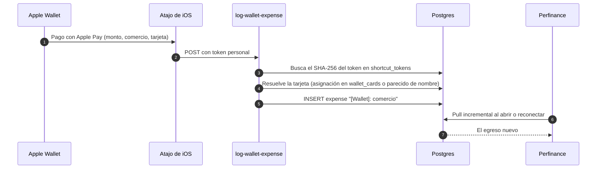
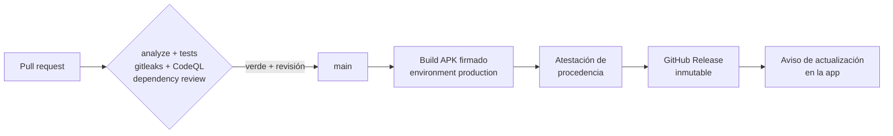

<div align="center">

# Perfinance

**Finanzas personales offline-first para iOS y Android.**
Registra tus egresos, tarjetas de crédito, deudas y lo que te deben. Funciona completa sin conexión
y se respalda en la nube cuando vuelve la señal.

[](https://github.com/yxd99/perfinance/actions/workflows/android-release.yml)
[](https://github.com/yxd99/perfinance/actions/workflows/security.yml)
[](https://github.com/yxd99/perfinance/releases/latest)
[](LICENSE)

Flutter · Riverpod · SQLite · Supabase (Postgres, Auth, Edge Functions) · Sentry

</div>

---

## Contenido

- [Funcionalidad](#funcionalidad)
- [Arquitectura](#arquitectura)
- [Sincronización](#sincronización)
- [Registro desde Apple Wallet](#registro-desde-apple-wallet)
- [Modelo de seguridad](#modelo-de-seguridad)
- [Estructura del proyecto](#estructura-del-proyecto)
- [Puesta en marcha](#puesta-en-marcha)
- [Tests y calidad](#tests-y-calidad)
- [Releases y verificación](#releases-y-verificación)
- [Contribuir](#contribuir) · [Seguridad](#seguridad) · [Licencia](#licencia)

## Funcionalidad

| Módulo | Qué hace |
| --- | --- |
| **Egresos** | Registra gastos con tarjeta de crédito o medio de pago, con filtros por fecha y medio de pago. La app registra solo egresos. |
| **Tarjetas de crédito** | Alias, día de corte, cuota de manejo, pago mínimo por mes y pagos. Se desactivan sin perder su historial. |
| **Ahorros** | Medios de pago: efectivo, débito u otro. |
| **Deudas** | Lo que debes, con abonos y estados `active`, `paid` o `hidden`. |
| **Me deben** | Lo que te deben, con abonos y estados `active`, `settled`, `written_off` o `hidden`. Si quien te debe usa la app, ve una copia de solo lectura en su cuenta y puede recibir un aviso por correo. |
| **Pagos automáticos** | Egresos recurrentes que se generan solos; se pueden pausar. |
| **Dashboard** | Deuda total, uso por tarjeta y comparativa contra el mes anterior. |
| **Apple Wallet** | Un atajo de iOS registra el egreso al pagar con Apple Pay, sin abrir la app. |
| **Exportar** | Envía tus egresos por correo en un archivo. |

## Arquitectura

La regla central: **toda lectura y escritura de la app va contra SQLite local**. Supabase es la copia
en la nube para respaldo y varios dispositivos; la app no lo necesita para funcionar.



### Capas en la app

| Capa | Ubicación | Responsabilidad |
| --- | --- | --- |
| Presentación | `lib/features/*` | Pantallas y widgets. Leen providers, nunca SQLite directo. |
| Estado | `lib/features/*/…_provider.dart` | `FutureProvider` de Riverpod sobre un repositorio, sin notifiers. Se invalidan tras escribir. |
| Datos | `lib/data/repositories` | Único acceso a SQLite. Cada escritura marca la fila con su `sync_status`. |
| Esquema | `lib/data/database/app_database.dart` | `createAppSchema` y `upgradeAppSchema` con migraciones por versión (`appSchemaVersion`). |
| Servicios | `lib/services` | Sincronización, conectividad y cálculos (pago mínimo, dashboard). |
| Núcleo | `lib/core` | Router (`go_router`), tema, configuración, observabilidad y aviso de actualización. |

Los saldos (deuda de una tarjeta, lo pagado de una deuda) se calculan en local sobre **todo el
historial**, por eso los datos locales nunca se recortan por fecha.

### Backend

| Pieza | Ubicación | Responsabilidad |
| --- | --- | --- |
| Migraciones | `supabase/migrations` | Esquema de Postgres, índices, triggers y políticas RLS, en orden `NNN_descripcion.sql`. |
| `trg_tombstone` | Trigger por tabla | Anota cada borrado en `deleted_records` para que los demás dispositivos lo repliquen. |
| `*_updated_at` | Trigger por tabla | Sella `updated_at` con la hora del servidor; es la base del pull incremental. |
| Deuda espejo | `007_cross_user_debt.sql` | Al registrar un "me deben" de un usuario existente le crea una deuda de solo lectura (`mirrored_debts`). |
| `log-wallet-expense` | Edge Function | Registra un egreso desde el atajo de iOS. |
| `send-expense-export` | Edge Function | Envía la exportación de egresos por correo. |
| `send-receivable-notification` | Edge Function | Avisa por correo a quien te debe, con lista de destinatarios permitidos y cuota mensual. |
| `delete-account` | Edge Function | Borra la cuenta y todos sus datos. |
| `financial-advisor` | Edge Function | Chat con asesor financiero (apagado por defecto en `lib/core/config/features.dart`). |

## Sincronización

### Escritura



### Reglas

- **Push**: sube solo filas con `sync_status` pendiente (`pending_insert`, `pending_update`,
  `pending_delete`) y las marca `synced` solo si Supabase las aceptó.
- **Pull incremental**: cada tabla pide solo las filas con `updated_at` posterior a su cursor. Los
  cursores usan la hora del servidor, viven en la tabla local `sync_cursors` y se guardan solo al
  terminar un pull completo. Sin cursor, la bajada es completa y paginada de a 1.000 filas.
- **Borrados**: se borra de verdad en Supabase; el trigger `trg_tombstone` lo anota en
  `deleted_records` y el pull elimina esas filas en los demás dispositivos.
- **Conflictos**: una fila con cambios pendientes nunca se pisa en el pull; al subir, gana el último push.
- **Cierre de sesión**: primero sube lo pendiente y pide confirmación si algo no pudo subirse; luego
  borra el archivo SQLite.



## Registro desde Apple Wallet

Es la única escritura que no pasa por SQLite: el egreso se crea en Supabase y llega al teléfono en el
siguiente pull.



## Modelo de seguridad

| Capa | Control |
| --- | --- |
| Datos | **RLS** activo en todas las tablas: cada usuario solo lee y escribe sus filas (`auth.uid()`). |
| Edge Functions | Validan el JWT de la sesión o, en Wallet, un token personal del que solo se guarda el hash SHA-256. |
| Correo | Lista de destinatarios permitidos y cuota mensual por cuenta para evitar abuso. |
| Claves en la app | Solo la URL y la `anon key` de Supabase, que son públicas por diseño. Se inyectan con `--dart-define`, nunca en el código. |
| Repositorio | `main` protegida por ruleset: PR revisado, checks en verde, commits firmados, historial lineal, sin force-push. |
| CI | Acciones fijadas por SHA, `GITHUB_TOKEN` de solo lectura, secretos de release en el environment `production` (solo `main`). |
| Análisis | gitleaks, CodeQL, dependency review, secret scanning con push protection y Dependabot. |
| Releases | Inmutables, con hash SHA-256 y atestación de procedencia firmada. |

Detalle y forma de reportar vulnerabilidades en [SECURITY.md](SECURITY.md).

## Estructura del proyecto

```text
lib/
├── core/            # config, router, tema, observabilidad, aviso de actualización
├── data/
│   ├── database/    # esquema SQLite y migraciones locales
│   ├── models/      # modelos con toJson/fromJson
│   └── repositories/# único acceso a SQLite
├── features/        # una carpeta por módulo: pantallas + providers
└── services/        # sincronización, conectividad, cálculos
supabase/
├── migrations/      # esquema de Postgres, triggers y RLS
└── functions/       # Edge Functions (Deno)
test/                # tests unitarios, de widgets y de contrato de esquema
docs/                # guías de release y operación
```

## Puesta en marcha

**Requisitos:** Flutter 3.47+, [Supabase CLI](https://supabase.com/docs/guides/cli) y un proyecto
propio de Supabase.

1. **Clona e instala dependencias**
   ```bash
   git clone https://github.com/yxd99/perfinance.git
   cd perfinance
   flutter pub get
   ```

2. **Aplica las migraciones** en tu proyecto de Supabase:
   ```bash
   supabase link --project-ref <tu-project-ref>
   supabase db push
   ```
   Todo cambio de esquema va como un archivo nuevo en `supabase/migrations/` y se aplica con
   `supabase db push`, nunca a mano desde el dashboard.

3. **Configura Auth**: en *Authentication → Providers → Email* puedes desactivar *Confirm email*
   para que el registro inicie sesión de inmediato.

4. **Configura la app** sin guardar secretos en el código:
   ```bash
   cp dart_defines.json.example dart_defines.json   # rellena SUPABASE_URL y SUPABASE_ANON_KEY
   flutter run --dart-define-from-file=dart_defines.json
   ```
   `dart_defines.json` está en `.gitignore`. Sin `SENTRY_DSN`, Sentry queda apagado.

5. **Edge Functions** (opcional):
   ```bash
   supabase secrets set RESEND_API_KEY=...
   supabase functions deploy send-expense-export
   ```

## Tests y calidad

```bash
flutter analyze
flutter test
```

- `openTestDatabase()` (`test/helpers/db_helper.dart`) levanta SQLite en memoria con el esquema real;
  con `fromVersion` prueba la migración desde un esquema histórico.
- `test/data/schema_contract_test.dart` falla si un modelo envía una columna que ninguna migración
  de Supabase crea. Es la red de seguridad contra el desfase entre el esquema local y el remoto.
- La lógica de sincronización vive en funciones puras testeables (`paged_fetch.dart`,
  `pull_cursor.dart`), porque `SyncService` depende de Supabase.

## Releases y verificación

Cada merge a `main` compila el APK firmado y publica un
[release](https://github.com/yxd99/perfinance/releases/latest) con el APK, su hash SHA-256 y el
manifiesto que usa el aviso de actualización de la app.



Para comprobar que un APK salió de este repositorio y no fue modificado:

```bash
gh attestation verify perfinance.apk --repo yxd99/perfinance
```

Más detalle en [`docs/release-android.md`](docs/release-android.md).

## Contribuir

Las contribuciones son bienvenidas. Lee [CONTRIBUTING.md](CONTRIBUTING.md) antes de abrir un PR:
explica el flujo, las reglas de esquema y el estilo. Al participar aceptas el
[Código de conducta](CODE_OF_CONDUCT.md).

## Seguridad

¿Encontraste una vulnerabilidad? **No abras un issue público**: repórtala en privado según
[SECURITY.md](SECURITY.md).

## Licencia

Distribuido bajo la licencia [MIT](LICENSE).
